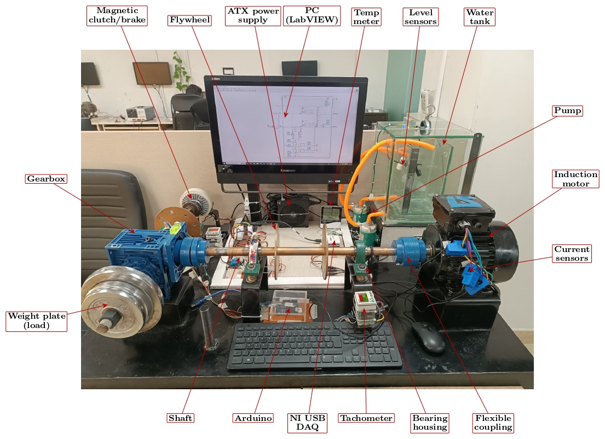
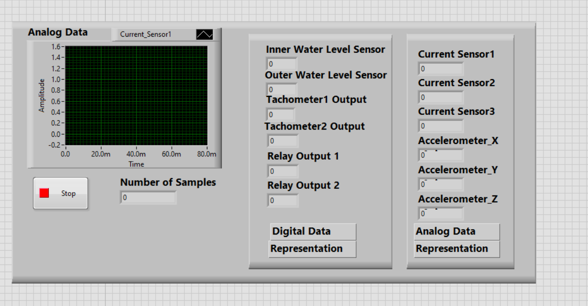
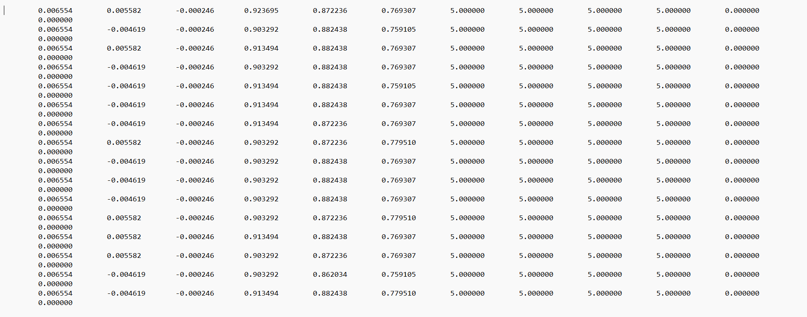
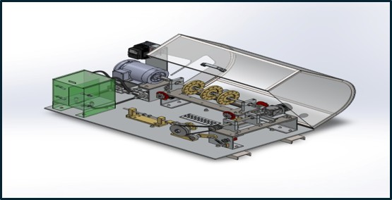
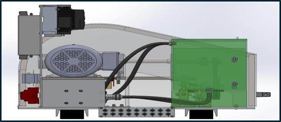
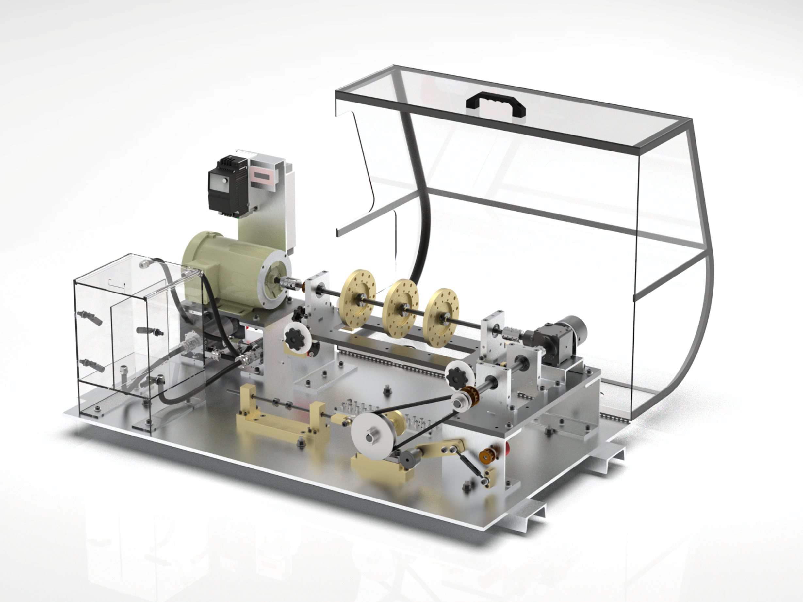

# Industrial Test Rig Simulator

A bench-scale rig for reproducing common industrial machine faults (unbalance, misalignment, bearing wear, abnormal load, flow/level faults, overcurrent) under controlled, repeatable conditions, with a full multi-sensor data-acquisition pipeline for predictive-maintenance research.


## Overview
The rig drives a rotating shaft (motor → flywheel/gear train) loaded by a magnetic powder brake, instrumented with vibration, current, temperature, speed, and liquid-level/flow sensors. Sensor signals are digitized through a DAQ (USB-6008 digital) and logged through a custom LabVIEW application, with Python used for downstream plotting/analysis. This lets known faults be injected and recorded as labeled datasets for later diagnostic/ML work.

**Features**
- Induction motor driven shaft with mechnical gearbox and adjustable mechanical load
- Fault injection: Load (weight plates, magnetic clutch/brake), flow/level (pump and water tank), Electrical (current), Bearing (Vibration)
- Sensors: Accelerometers, Current sensors, Tachometer, Temperature/humidity, Water level
- Data acquisition with NI USB DAQ and Arduino, logged through LabVIEW



## System Architecture
The Industrial Test Rig replicates the behaviour of industrial equipment’s at a smaller level without damaging the actual equipment which is being used in complex areas such as plants / industry.For this a small setup in designed and developed on which multiples analog and digital sensors have been installed on the system. In this system, it will actually monitor the status of the sensor and determine the remaining useful life of the equipment’s.


**Mechanical / drive:** AC motor → gear/flywheel assembly → magnetic powder brake (adjustable load), with a tachometer for shaft speed.

**Sensors:**
- 3-axis accelerometers (MPU9250)
- Current sensors (per phase of 3 phase Induction Motor) 
- Tachometer (speed/RPM)
- Inner/outer tank water level sensors 
- Encoder feedback

**Power / control:** ATX power supply, 2-channel relay switching, magnetic powder brake controller, 24V/12V/5V power distribution.

**Acquisition:** NI USB 6008 DAQ (digital + analog sensors data on analog / digital channels) → LabVIEW VI → LVM logs for data capturing.

**Synthetic Data Generation:** The Custom data is obtained using NI DAQ which is further used for AI model so that the remaining useful life of sensors can be achieved and for futuristic predictive maintaince.

## Repository Structure

```
Industrial-Test-Rig-Simulator/
├── README.md
│
├── Old_Design/                    V1.0: built and working test rig
│   ├── hardware/
│   │   └── altium/                PCB schematics: power distribution & sensor interface (Altium project, schematic, history)
│   ├── firmware/
│   │   ├── labview/               LabVIEW acquisition VI (Sensor_data.vi)
│   │   └── python/                Python scripts for accelerometer streaming/logging (Main_data.py) and plotting (plotting_data.py)
│   ├── data/
│   │   └── sample_datasets/       Example .lvm acquisition runs (no-load, 2/5/7/10 kg load cases) + column reference file
│   ├── docs/                      Hardware description, block diagram, wiring & connection diagrams, LabVIEW implementation, sensor list/BOM
│   └── images/                    Build photos, sensor and component pictures, LabVIEW GUI, sample plots
│
└── New_Design/                    V2.0: under development (industrial-grade sensors)
    ├── Images/                    CAD renders and design overview
    └── docs/                      Sensor description, power requirements and output signals (Test_Rig_Design_Sensor_Description.xlsx)
```

## Hardware

The sensor-interface and power-distribution of the system was designed in Altium (`hardware/altium/`), handling 24V/12V/5V rail distribution to sensors and the brake controller, and routing analog/digital sensor lines to the DAQ. See `Old_Design/docs/Test_Rig_Sensors.xlsx` for the full bill of materials and for sensor specs.

Electrical Schematic: [`Old_Design/docs/Hardware_Connection`](Old_Design/docs/Hardware_Connection) 

Sensors Power Supply and Output: [`Old_Design/docs/Hardware_Wiring.xlsx`](Old_Design/docs/Hardware_Wiring.xlsx)

Detailed Description of Sensors and Wiring: [`Old_Design/docs/Industrial_test_Rig_Hardware_Description.pdf`](Old_Design/docs/Industrial_test_Rig_Hardware_Description.pdf)
## Software

- **LabVIEW** (`Old_Design/firmware/software/labview/Sensor_data.vi`) performs synchronized multi-channel data acquisition from the NI DAQ and records timestamped sensor measurements for analysis and condition monitoring.



- **Firmware** (`Old_Design/firmware/python/Main_data.py`) The Arduino continuously streams raw X, Y, and Z-axis accelerometer readings over a serial interface for standalone vibration capture. The accelerometer data is synchronized with the LabVIEW-based DAQ measurements, allowing both datasets to be acquired and logged into a single unified data file for subsequent vibration analysis, signal processing, and condition-monitoring applications.

## Sample Data

`Old_Design/data/sample_datasets/` contains representative acquisition runs at no-load and 2/5/7/10 kg wight loads, plus example current-sensor and accelerometer captures — useful for quick inspection of signal behavior without running the rig.


Dataset Column Representation: For an overview of the dataset structure and column representation, refer to the sample datasets available in [`Old_Design/data/sample_datasets`](Old_Design/data/sample_datasets) 

# Industrial Test Rig Simulator V2.0
The Industrial Test Rig Simulator V2.0 is currently under development, with a redesigned architecture incorporating industrial-grade sensors and advanced instrumentation. The new design is intended to replicate more complex operating conditions and fault scenarios commonly encountered in predictive maintenance and industrial condition monitoring.
V2.0 focuses on improving the realism and capabilities of the test rig by integrating advanced sensing, data acquisition, and monitoring systems, enabling a closer representation of real-world industrial equipment and fault conditions.

The 3D design of the Industrial Test Rig Simulator V2.0 is shown below.




**Sensors Power Supply and Output:** The V2.0 design incorporates upgraded industrial sensors for comprehensive monitoring of vibration, acoustic emissions, temperature, current, speed, and liquid-level conditions. Detailed information on sensor specifications, power requirements, and output signals is provided in[`New_Design/docs/Test_Rig_Design_Sensor_Description`](New_Design/docs/Test_Rig_Design_Sensor_Description.xlsx)


## Author

Muhammad Huzaifa Rahim Malik — designed and built as part of applied predictive-maintenance / industrial sensing work.
