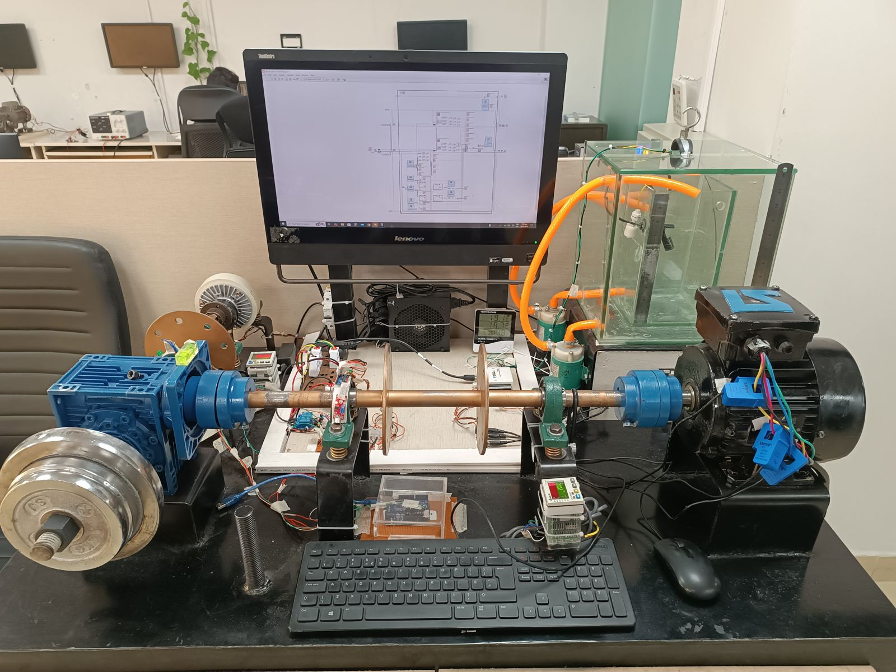
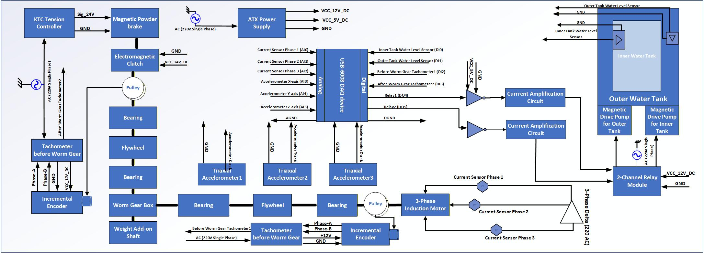

# Industrial Test Rig Simulator

A bench-scale rig for reproducing common industrial machine faults (unbalance, misalignment, bearing wear, abnormal load, flow/level faults, overcurrent) under controlled, repeatable conditions, with a full multi-sensor data-acquisition pipeline for predictive-maintenance research.



## Overview

The rig drives a rotating shaft (motor → flywheel/gear train) loaded by a magnetic powder brake, instrumented with vibration, current, temperature, speed, and liquid-level/flow sensors. Sensor signals are digitized through a DAQ (USB-6008 digital + Advantech analog channels) and logged through a custom LabVIEW application, with Python used for downstream plotting/analysis. This lets known faults be injected and recorded as labeled datasets for later diagnostic/ML work.

## System Architecture



**Mechanical / drive:** AC motor → gear/flywheel assembly → magnetic powder brake (adjustable load), with a tachometer for shaft speed.

**Sensing:**
- 3-axis accelerometers (vibration, CMCP760T-2 type)
- Current sensors (per phase)
- Thermocouple (KTC) temperature sensing
- Tachometer (speed/RPM)
- Inner/outer tank water level sensors (float + flow)
- Encoder feedback

**Power / control:** ATX power supply, 2-channel relay switching, magnetic powder brake controller, 24V/12V/5V distribution.

**Acquisition:** NI/Advantech DAQ (digital I/O + analog current/vibration channels) → LabVIEW VI → CSV/LVM logs → Python plotting.

Full signal map and wiring: [`docs/Block_Diagram.pdf`](docs/Block_Diagram.pdf) · Complete hardware writeup: [`docs/Hardware_Description.pdf`](docs/Hardware_Description.pdf)

## Repository Structure

```
hardware/altium/     PCB schematics — power distribution & sensor interface board (Altium)
firmware/             Microcontroller code (accelerometer XYZ acquisition, Arduino)
software/labview/     LabVIEW acquisition VI
software/python/      Python scripts for logging/plotting acquired sensor data
data/sample_datasets/ Example .lvm/.csv acquisition runs (no-load, 2/5/7/10 kg load cases)
docs/                 Hardware description, block diagram, parts list, sensor spec sheets
images/               Build photos, sensor setup, GUI, sample plots
media/                (local only — demo videos; see note below)
```

## Hardware

The sensor-interface and power-distribution PCB was designed in Altium (`hardware/altium/`), handling 24V/12V/5V rail distribution to sensors and the brake controller, and routing analog/digital sensor lines to the DAQ. See `docs/Test_Rig_Parts.xlsx` for the full bill of materials and `docs/Sensor_Description.xlsx` for sensor specs.

## Software

- **LabVIEW** (`software/labview/Sensor_data.vi`) performs synchronized multi-channel acquisition from the DAQ and writes timestamped logs.
- **Python** (`software/python/Main_data.py`, `plotting_data.py`) post-processes and visualizes the logged sensor data (see `images/Sample_Data_Plot.png` for an example).
- **Firmware** (`firmware/Accelerometer_data_fetch_xyz_code.ino`) streams raw XYZ accelerometer readings over serial for standalone vibration capture.

## Sample Data

`data/sample_datasets/` contains representative acquisition runs at no-load and 2/5/7/10 kg brake loads, plus example current-sensor and accelerometer captures — useful for quick inspection of signal behavior without running the rig.

## Notes

- Demo/setup videos (~180 MB) were left out of this repository to keep it lightweight; they're available on request or can be linked here via YouTube/Drive.
- Altium version-history (`History/`) and IDE/cache folders from the original working directory were excluded as non-essential.

## Author

Muhammad Huzaifa Rahim Malik — designed and built as part of applied predictive-maintenance / industrial sensing work.
